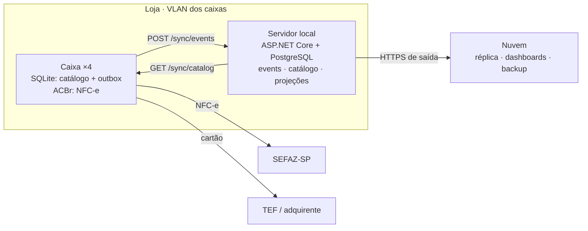

# PDV Synthia

[](https://github.com/lacerdaaa/pdv-synthia/actions/workflows/ci.yml)


PDV offline-first para o **Market SP**: quatro caixas que vendem sozinhos, um servidor local que consolida e uma
nuvem que é só cópia.

> **O caixa vende sem depender de nada além dele mesmo**, do pinpad e (para NFC-e normal) da internet.
> Servidor e nuvem são para consolidar, não para vender.

**Documentação interativa:** rode o servidor e abra **http://localhost:5290/docs**. Lá estão a arquitetura, um
simulador de sync, o catálogo de eventos e um **console de API ao vivo** gerado do OpenAPI, no estilo Swagger.

---

## Sumário

- [Princípios](#princípios)
- [Arquitetura](#arquitetura)
- [Como a sincronização funciona](#como-a-sincronização-funciona)
- [Stack](#stack)
- [Começando](#começando)
- [Documentação e console de API](#documentação-e-console-de-api)
- [API](#api)
- [Eventos](#eventos)
- [Conflitos viram regras](#conflitos-viram-regras)
- [Cenários de falha](#cenários-de-falha)
- [Simulação de um dia de loja](#simulação-de-um-dia-de-loja)
- [Estrutura do repositório](#estrutura-do-repositório)
- [Testes](#testes)
- [Roadmap e decisões em aberto](#roadmap-e-decisões-em-aberto)
- [Convenções](#convenções)

## Princípios

| Princípio | Na prática |
|---|---|
| **Offline-first no caixa** | Catálogo, preços e venda vivem em SQLite local. Servidor fora do ar = caixa continua. |
| **Eventos imutáveis, não estado compartilhado** | O caixa nunca faz `UPDATE` remoto. Registra fatos (venda, cancelamento, sangria); o servidor deriva estoque e saldos. |
| **Um dono por dado** | Vendas nascem no caixa; catálogo e preço nascem no back-office. Cada lado só escreve o que é seu. |
| **Entrega pelo menos uma vez + idempotência** | Reenviar é sempre seguro: `event_id` é chave primária no servidor. |
| **Nuvem é cópia, não fonte** | A loja funciona 100% sem internet, exceto TEF e autorização online de NFC-e. |

## Arquitetura



Os caixas falam direto com SEFAZ e TEF. O servidor só recebe eventos e distribui catálogo; a nuvem recebe cópia de
tudo pelo servidor.

## Como a sincronização funciona

**Caixa → servidor (vendas).** Cada fato é gravado na tabela `outbox` na **mesma transação SQLite** que o gerou.
Um worker em background empurra a outbox em lotes; o operador nunca espera por isso.

```mermaid
sequenceDiagram
  participant Op as Operador
  participant CX as Caixa (SQLite)
  participant W as OutboxPusher
  participant S as Servidor (Postgres)
  Op->>CX: finaliza venda
  CX->>CX: BEGIN · SaleCompleted → outbox · COMMIT
  CX-->>W: Notify()
  loop a cada 2 s ou logo após a venda
    W->>S: POST /sync/events (até 100, ordem de event_id)
    S->>S: INSERT … ON CONFLICT DO NOTHING<br/>+ projeções na mesma transação
    S-->>W: accepted [event_id…]
    W->>CX: marca sent_at
  end
  Note over W,S: erro ou timeout → backoff 2 s → 60 s;<br/>reenvio é inofensivo
```

**Servidor → caixas (catálogo).** Toda alteração no back-office grava uma linha em `catalog_changes` com `version`
sequencial (escritores serializados por advisory lock). A cada 30 s o caixa pede
`GET /sync/catalog?since=<versão>` e aplica só o delta; se estiver muito atrasado, baixa o snapshot.
Preços agendados chegam antes e são aplicados pelo próprio caixa no horário, mesmo offline.

**IDs.** Todo registro usa **UUIDv7 gerado na origem**, estritamente crescente no processo (`Uuid7`), então o
caixa nunca pede ID ao servidor e uma venda nunca é ordenada depois do próprio cancelamento.

## Stack

| Camada | Tecnologia | Por quê |
|---|---|---|
| Linguagem | C# / .NET 10 (LTS) | Uma linguagem do caixa à nuvem; contratos compartilhados; ACBrLib tem binding .NET. |
| Caixa · dados | SQLite (Microsoft.Data.Sqlite + Dapper), WAL | Arquivo local e transacional; o worker lê sem bloquear a venda. |
| Caixa · fiscal | ACBrLib NFC-e *(a integrar)* | Série própria por caixa, certificado A1 local, contingência tpEmis 9. |
| Caixa · interface | Avalonia *(proposta)* | Desktop .NET para Windows/Linux sobre o mesmo `Terminal.Core`. |
| Servidor | ASP.NET Core minimal API | HTTP simples; polling basta para 4 caixas. |
| Servidor · dados | PostgreSQL 16 (Npgsql + Dapper) | SQL explícito, `jsonb`, projeções reconstruíveis. |
| Documentação | OpenAPI nativo do .NET + página própria em `/docs` | Console de API ao vivo sem dependências externas. |
| Testes | xUnit, Postgres real, `FakeTimeProvider` | Integração do servidor e ponta a ponta caixa → servidor. |

## Começando

Requisitos: **.NET 10 SDK** e **PostgreSQL 16**.

```bash
# 1. banco de desenvolvimento (usuário e senha: synthia)
createuser -s synthia --pwprompt
createdb -O synthia synthia

# 2. servidor: aplica as migrações na subida
dotnet run --project src/Synthia.Server
# → http://localhost:5290/docs

# 3. testes (o usuário precisa poder criar bancos)
export SYNTHIA_TEST_PG="Host=localhost;Username=synthia;Password=synthia;Database=postgres"
dotnet test
```

A connection string do servidor fica em `src/Synthia.Server/appsettings.Development.json`
(`ConnectionStrings:Synthia`) e pode ser sobrescrita por variável de ambiente
(`ConnectionStrings__Synthia`).

## Documentação e console de API

O servidor serve a pasta [`docs/`](docs) e o documento OpenAPI:

| URL | O quê |
|---|---|
| `/` | Redireciona para `/docs/` |
| [`/docs/`](docs/index.html) | Arquitetura, topologia clicável, simulador de sync, eventos, **console de API ao vivo**, falhas, decisões |
| [`/docs/simulacao.html`](docs/simulacao.html) | Execução real de um dia de loja, passo a passo |
| `/openapi/v1.json` | Documento OpenAPI 3 com todas as rotas, tags, resumos e schemas |

O console lê `/openapi/v1.json` e monta, para cada rota, um formulário com parâmetros e corpo de exemplo prontos
(IDs UUIDv7 novos a cada exemplo). **As chamadas são reais e gravam no banco do servidor.** Aberto direto como
arquivo, a página mostra a lista estática da API.

## API

| Método | Rota | O que faz |
|---|---|---|
| `POST` | `/sync/events` | Caixa envia lote (até 1000) de eventos. Devolve todos os `event_id` aceitos, inclusive os já existentes. |
| `GET` | `/sync/catalog?since={versão}` | Delta do catálogo em páginas de 500; `snapshotRequired` quando o caixa é novo, está à frente ou muito atrás. |
| `GET` | `/sync/catalog/snapshot` | Catálogo completo + preços agendados ainda válidos, numa leitura consistente. |
| `GET` | `/backoffice/products` | Cadastro atual. |
| `PUT` | `/backoffice/products/{id}` | Cria/altera produto e gera nova versão. Exclusão é `active = false`. |
| `POST` | `/backoffice/scheduled-prices` | Agenda preço para `effectiveAt`. |
| `POST` | `/backoffice/projections/rebuild` | Apaga as projeções e relê todo o log de eventos. |
| `GET` | `/health` | Verifica se o servidor está no ar. |

<details>
<summary>Exemplo: enviar uma venda</summary>

```http
POST /sync/events
Content-Type: application/json

{
  "events": [{
    "eventId": "01a14ae5-522d-7b3e-b6c0-264b99bcd42b",
    "streamId": "01a14ae5-522b-7183-b2f9-c526fa0733e6",
    "streamSeq": 1,
    "type": "SaleCompleted",
    "terminalId": "CX01",
    "occurredAt": "2026-10-17T17:25:05.197Z",
    "catalogVersion": 8,
    "payload": {
      "saleId": "01a14ae5-522b-7183-b2f9-c526fa0733e6",
      "shiftId": "01a14adc-b598-7da0-9d48-8c1f0e3a2b11",
      "items": [{ "itemId": "…", "productId": "…", "description": "Arroz 5kg",
                  "quantity": 2, "unitPriceCents": 2899, "totalCents": 5798 }],
      "payments": [{ "method": "cash", "amountCents": 6000, "tefNsu": null }],
      "totalCents": 5798, "changeCents": 202,
      "nfceKey": "3526…", "nfceStatus": "authorized"
    }
  }]
}
```

```json
{ "accepted": ["01a14ae5-522d-7b3e-b6c0-264b99bcd42b"] }
```
</details>

## Eventos

Todos com o mesmo envelope: `event_id`, `stream_id`, `stream_seq`, `type`, `terminal_id`, `occurred_at`,
`catalog_version`, `payload`. Valores monetários em **centavos**; quantidades em decimal (kg com 3 casas).

| Evento | Stream | Efeito no servidor |
|---|---|---|
| `ShiftOpened` | turno | Cria o turno com operador e fundo de troco. |
| `SaleCompleted` | venda | Baixa estoque, soma no turno, NFC-e pendente/rejeitada entra na fila. |
| `SaleItemCancelled` | venda | Estorna estoque e valor; com `refundMethod = cash`, sai do dinheiro esperado. |
| `SaleCancelled` | venda | Estorna itens ainda não estornados e o dinheiro ainda na gaveta; sai da fila de NFC-e. |
| `CashWithdrawal` | turno | Soma em sangrias. |
| `ShiftClosed` | turno | Guarda o dinheiro declarado para conferência. |
| `StockCounted` | produto | Saldo passa a ser a contagem + movimentos posteriores. |
| `NfceAuthorized` | venda | Remove da fila de NFC-e. |
| `NfceRejected` | venda | Fila do back-office com código e motivo. |

## Conflitos viram regras

| Situação | Regra |
|---|---|
| Dois caixas vendem a última unidade | Venda nunca é bloqueada. Estoque fica negativo e vira alerta. Estoque é ledger, não número editado. |
| Caixa offline vendeu com preço antigo | Vale o preço da venda; o evento carrega preço praticado e `catalog_version`. |
| Produto excluído vendido offline | Exclusão é lógica; o evento continua válido e referencia o ID. |
| Cancelamento | Sempre evento novo, nunca alteração do original. |
| Ajuste de inventário no expediente | `StockCounted` com timestamp; movimentos posteriores somam sobre a contagem. |

## Cenários de falha

| Falha | O que acontece | Recuperação |
|---|---|---|
| Servidor local cai | Caixas vendem; outbox acumula; catálogo congela | Servidor volta e drena as outboxes sozinho |
| Internet principal cai | Roteador muda para 4G | Automática |
| Internet total cai | Dinheiro: NFC-e em contingência. Cartão: só com fallback do adquirente | Transmissão das pendentes quando voltar |
| Nuvem cai | Nada muda na loja | Servidor reenvia o acumulado |
| Disco do caixa morre | Perde só eventos ainda não enviados (segundos) | Reinstala e baixa snapshot |
| Disco do servidor morre | Caixas seguem vendendo | `pg_dump` + replay das outboxes (30 dias) |

## Simulação de um dia de loja

[`tools/Synthia.Simulator`](tools/Synthia.Simulator) roda 27 passos (abertura, vendas, servidor fora, resposta
perdida, internet fora, contingência, conflitos, preço agendado, fechamento e rebuild) contra um **servidor real** e
**dois caixas reais**, gravando cada passo como *situação → rota → processo → resposta → efeito*.

```bash
tools/simulate.sh          # sobe servidor descartável, roda o roteiro e gera docs/simulacao-data.js
```

O resultado fica em [`/docs/simulacao.html`](docs/simulacao.html). Foi essa simulação que encontrou o bug do
estorno em dinheiro fora da gaveta, já corrigido.

## Estrutura do repositório

```
src/
  Synthia.Contracts        envelope, payloads, mensagens de sync, Uuid7, JSON comum
  Synthia.Terminal.Core    LocalDb, Outbox, LocalCatalog, Cart, SaleService, ShiftService,
                           OutboxPusher, CatalogPuller, INfceEmitter
  Synthia.Server           Migrator + SQL, EventStore, Projector, CatalogService, OpenAPI, /docs
tests/
  Synthia.Terminal.Tests   caixa com SQLite temporário, relógio e servidor falsos
  Synthia.Server.Tests     servidor contra Postgres real, docs/OpenAPI, ponta a ponta
tools/
  Synthia.Simulator        roteiro de um dia de loja
  simulate.sh              executa o simulador contra um servidor descartável
docs/
  index.html               documentação interativa + console de API
  simulacao.html           visualizador da simulação
```

## Testes

```bash
dotnet test
```

- **Caixa:** venda, troco, balança, contingência, turno, preço agendado, exclusão lógica, outbox em lotes,
  drenagem após queda, poda de 30 dias, ordem do `Uuid7`.
- **Servidor:** idempotência, estoque negativo, contagem, cancelamentos e devoluções na gaveta, fila de NFC-e,
  rebuild, delta/snapshot do catálogo, `/docs` e OpenAPI.
- **Ponta a ponta:** caixa SQLite baixa catálogo, vende e o servidor Postgres projeta estoque e turno.

O CI (GitHub Actions) roda build e testes com um Postgres 16 de serviço.

## Roadmap e decisões em aberto

- [ ] Integração ACBrLib (emissão, contingência, worker de transmissão, inutilização no fim do dia)
- [ ] Interface do caixa (proposta: Avalonia) e tela de inventário
- [ ] Back-office web e fila de NFC-e rejeitadas
- [ ] Autenticação dos caixas na API de sync (chave por terminal ou mTLS na VLAN)
- [ ] Outbox servidor → nuvem e serviço da nuvem
- [ ] Servidor com standby ou aceitar horas fora? · Edição de preço pela nuvem no MVP?
- [ ] TEF: PayGo ou SiTef, e fallback offline para cartão
- [ ] Contador: CSOSN/CST, NCM e regime tributário antes da primeira NFC-e em produção

## Convenções

- Commits em inglês no padrão [Conventional Commits](https://www.conventionalcommits.org/)
  (`feat(server): …`, `fix(terminal): …`, `docs: …`), pequenos e focados.
- Código e comentários em português do domínio (caixa, sangria, turno); identificadores em inglês.
- Dinheiro sempre em centavos (`long`); datas em UTC.
