<p align="center"></p>

# PDV Synthia

[](https://github.com/lacerdaaa/pdv-synthia/actions/workflows/ci.yml)


PDV offline-first para supermercados: caixas que vendem sozinhos, um servidor local que consolida e uma nuvem que
é só cópia. Nasceu para o **Xandão Supermercados** (projeto Market SP), o cliente zero, e é um produto multi-loja:
nome, logo, cores e dados do cupom de cada loja ficam no cadastro da retaguarda, não no código.

> **O caixa vende sem depender de nada além dele mesmo**, do pinpad e (para NFC-e normal) da internet.
> Servidor e nuvem são para consolidar, não para vender.

**Documentação interativa:** rode o servidor e abra **http://localhost:5290/docs**. Lá estão a arquitetura, um
simulador de sync, o catálogo de eventos e um **console de API ao vivo** gerado do OpenAPI, no estilo Swagger.

---

## Sumário

- [Princípios](#princípios)
- [Arquitetura](#arquitetura)
- [Como a sincronização funciona](#como-a-sincronização-funciona)
- [Stack](#stack)
- [O caixa](#o-caixa)
- [Retaguarda](#retaguarda)
- [Segurança](#segurança)
- [Hardware do caixa](#hardware-do-caixa)
- [Começando](#começando)
- [Documentação e console de API](#documentação-e-console-de-api)
- [API](#api)
- [Eventos](#eventos)
- [Conflitos viram regras](#conflitos-viram-regras)
- [Cenários de falha](#cenários-de-falha)
- [Simulação de um dia de loja](#simulação-de-um-dia-de-loja)
- [Estrutura do repositório](#estrutura-do-repositório)
- [Testes](#testes)
- [Roadmap e decisões em aberto](#roadmap-e-decisões-em-aberto)
- [Convenções](#convenções)

## Princípios

| Princípio | Na prática |
|---|---|
| **Offline-first no caixa** | Catálogo, preços e venda vivem em SQLite local. Servidor fora do ar = caixa continua. |
| **Eventos imutáveis, não estado compartilhado** | O caixa nunca faz `UPDATE` remoto. Registra fatos (venda, cancelamento, sangria); o servidor deriva estoque e saldos. |
| **Um dono por dado** | Vendas nascem no caixa; catálogo e preço nascem no back-office. Cada lado só escreve o que é seu. |
| **Entrega pelo menos uma vez + idempotência** | Reenviar é sempre seguro: `event_id` é chave primária no servidor. |
| **Nuvem é cópia, não fonte** | A loja funciona 100% sem internet, exceto TEF e autorização online de NFC-e. |

## Arquitetura

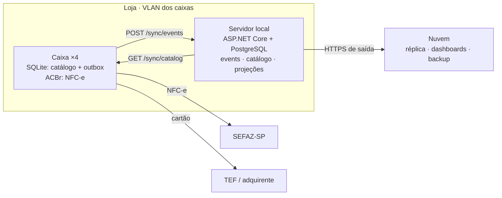

Os caixas falam direto com SEFAZ e TEF. O servidor só recebe eventos e distribui catálogo; a nuvem recebe cópia de
tudo pelo servidor.

## Como a sincronização funciona

**Caixa → servidor (vendas).** Cada fato é gravado na tabela `outbox` na **mesma transação SQLite** que o gerou.
Um worker em background empurra a outbox em lotes; o operador nunca espera por isso.

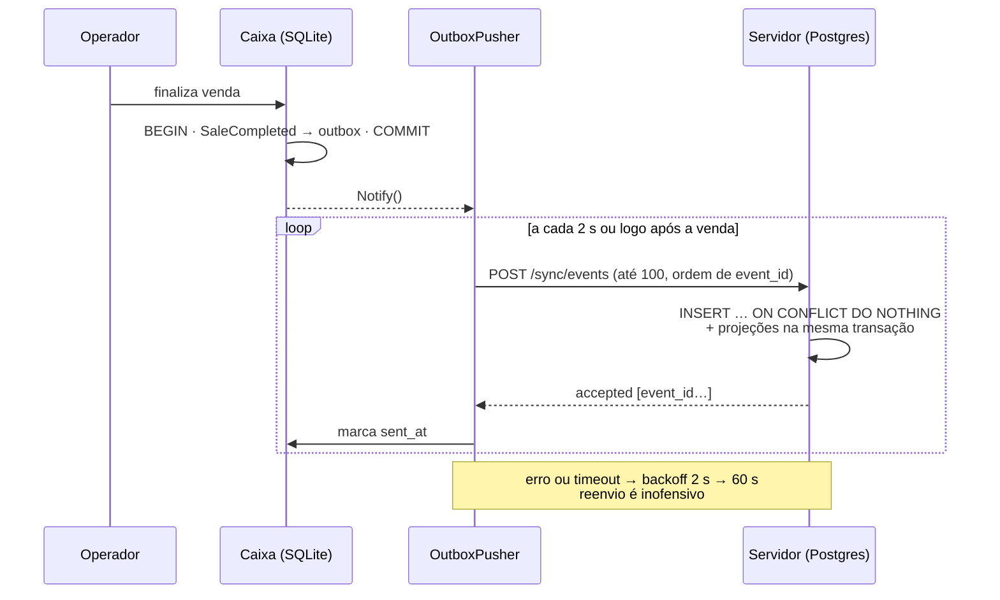

**Servidor → caixas (catálogo).** Toda alteração no back-office grava uma linha em `catalog_changes` com `version`
sequencial (escritores serializados por advisory lock). A cada 30 s o caixa pede
`GET /sync/catalog?since=<versão>` e aplica só o delta; se estiver muito atrasado, baixa o snapshot.
Preços agendados chegam antes e são aplicados pelo próprio caixa no horário, mesmo offline.

**IDs.** Todo registro usa **UUIDv7 gerado na origem**, estritamente crescente no processo (`Uuid7`), então o
caixa nunca pede ID ao servidor e uma venda nunca é ordenada depois do próprio cancelamento.

## Stack

| Camada | Tecnologia | Por quê |
|---|---|---|
| Linguagem | C# / .NET 10 (LTS) | Uma linguagem do caixa à nuvem; contratos compartilhados; ACBrLib tem binding .NET. |
| Caixa · dados | SQLite (Microsoft.Data.Sqlite + Dapper), WAL | Arquivo local e transacional; o worker lê sem bloquear a venda. |
| Caixa · fiscal | ACBrLib NFC-e *(a integrar)* | Série própria por caixa, certificado A1 local, contingência tpEmis 9. |
| Caixa · dispositivos | ESC/POS, protocolo Toledo, System.IO.Ports | Padrões de mercado; trocar de modelo é configuração. |
| Caixa · interface | Avalonia 12 (MVVM, CommunityToolkit) | App desktop para Windows/Linux sobre o `Terminal.Core`; testado headless. |
| Servidor | ASP.NET Core minimal API | HTTP simples; polling basta para 4 caixas. |
| Servidor · dados | PostgreSQL 16 (Npgsql + Dapper) | SQL explícito, `jsonb`, projeções reconstruíveis. |
| Retaguarda | Blazor Server + cookie auth | Back-office na rede da loja, mesmo processo e mesmos serviços do servidor. |
| Documentação | OpenAPI nativo do .NET + página própria em `/docs` | Console de API ao vivo sem dependências externas. |
| Testes | xUnit, Postgres real, `FakeTimeProvider` | Integração do servidor e ponta a ponta caixa → servidor. |

## O caixa

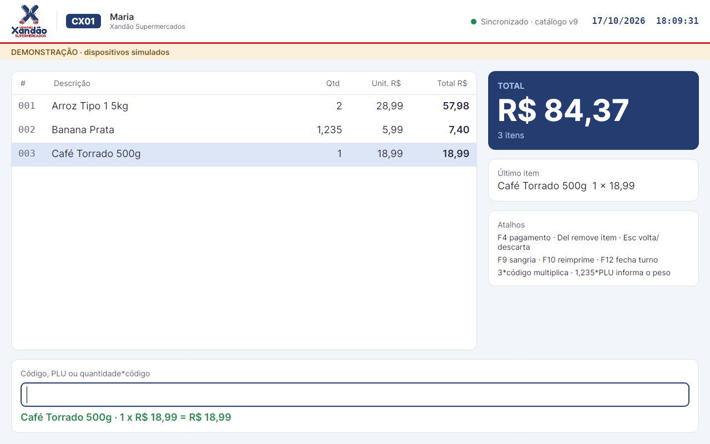

App desktop em Avalonia sobre o `Terminal.Core`: toda a regra de venda está na `CheckoutSession` (testada sem
interface) e a tela só repassa o teclado. Operação inteira pelo teclado, como nos PDVs de mercado. Visual
Synthia (Petróleo `#0B5563`, Amarelo Etiqueta `#FFC94A`, fundo Papel `#F7F5F0`), com Archivo no total e nos preços
e Atkinson Hyperlegible Next no texto, as duas embutidas no app (OFL, licenças em `Licenses/`).

```bash
# experimentar sem servidor nem hardware (dispositivos simulados, catálogo de exemplo, banco caixa-demo.db)
dotnet run --project src/Synthia.Terminal.App -- --demo

# caixa de verdade: terminal.json ao lado do executável, ou
dotnet run --project src/Synthia.Terminal.App -- --config caminho/terminal.json
```

| Tecla | Ação |
|---|---|
| `Enter` | Registra o código; no pagamento, recebe em dinheiro (vazio = restante) |
| `3*código` · `1,235*PLU` | Multiplica · informa o peso sem balança |
| `PLU` | Produto pesado: lê a balança do caixa |
| `F4` | Pagamento |
| `F5` `F6` `F7` `F8` | Dinheiro · débito · crédito · PIX (TEF) |
| `Del` | Remove item (antes de finalizar) |
| `Esc` | Sai do pagamento estornando o TEF · 2× descarta a venda |
| `F9` · `F10` · `F12` | Sangria · reimprime · fecha turno |

Ao finalizar: grava `SaleCompleted` na outbox, emite a NFC-e (simulada, com numeração e chave reais da série do
caixa), imprime o DANFE e a via do TEF, e abre a gaveta se houve dinheiro. Impressora fora do ar não impede a
venda: o operador reimprime com `F10`. O topo mostra operador, eventos pendentes de envio e versão do catálogo; em
homologação, uma faixa avisa que a NFC-e não tem valor fiscal.

| Abrir turno | Pagamento | Finalizada |
|---|---|---|
| 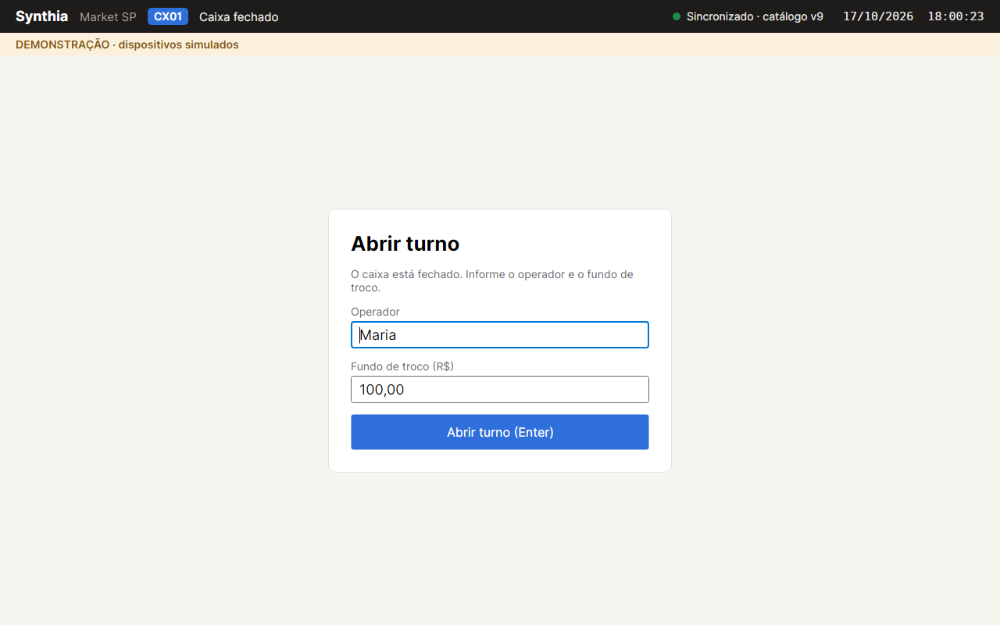 | 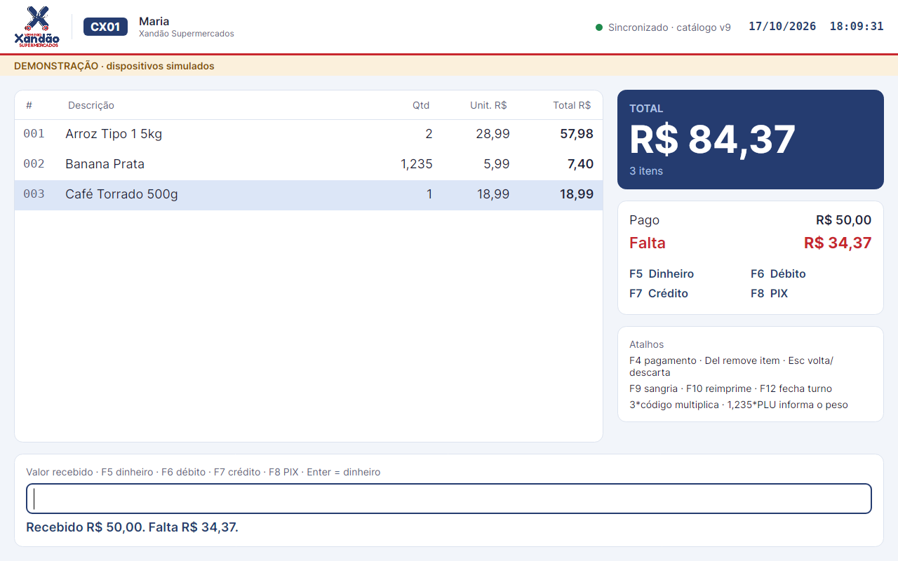 | 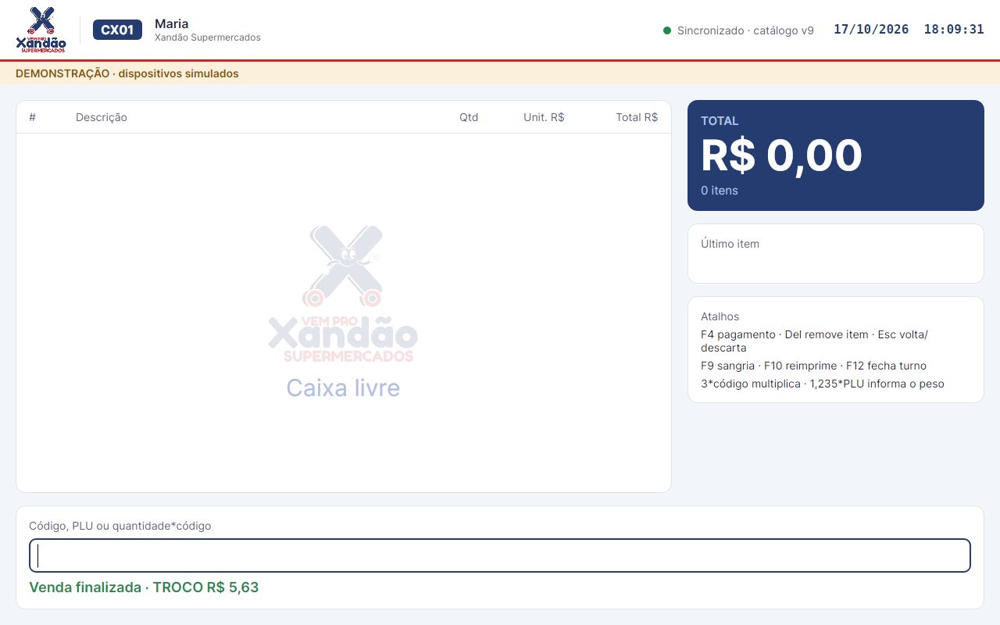 |

## Retaguarda

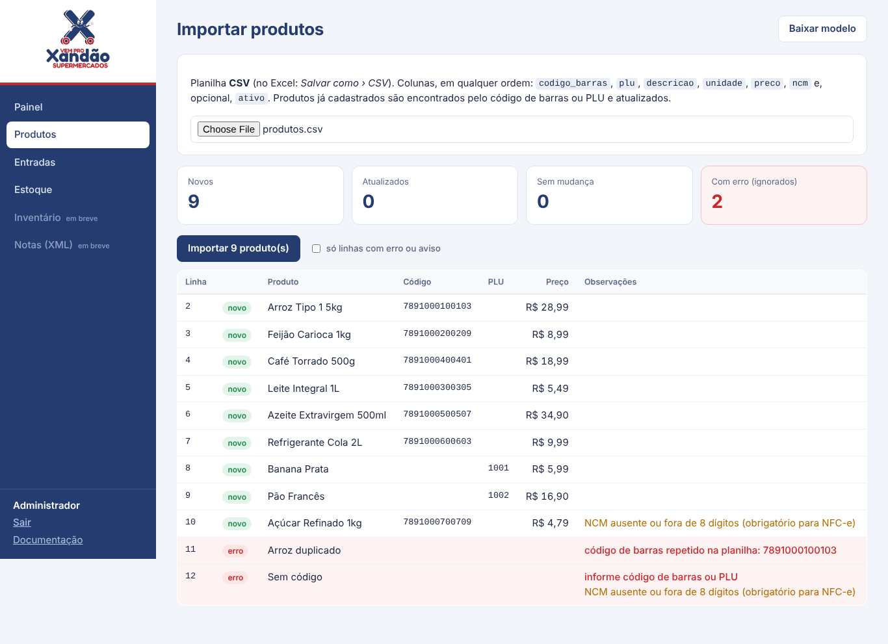

Back-office web em **Blazor Server**, servido pelo próprio servidor da loja em **http://localhost:5290/retaguarda**:
funciona em qualquer navegador da rede da loja, sem instalar nada e sem depender de internet. Separado do caixa de
propósito: outras pessoas (gerente, estoquista), outros lugares (escritório, depósito) e o caixa continua só vendendo.

| Tela | O que faz |
|---|---|
| Painel | Indicadores e o **roteiro de implantação do mercado novo**, marcando o que já foi feito |
| Produtos | Busca, cadastro, edição e **importação de planilha** com prévia (novos, atualizados, erros e avisos por linha) |
| Entradas | **Transferência da loja antiga**, fornecedor sem XML ou outra; itens bipados ou por planilha |
| Notas (XML) | **XML da NF-e do fornecedor**: vincula itens pelo código de barras, converte caixa/fardo em unidades, aprende o vínculo, cadastra produto novo pela nota e bloqueia nota duplicada |
| Estoque | Saldo por produto, filtro de negativos e histórico de movimentos de cada produto |
| Inventário | Contagem por setor ou **geral** (zera o não contado), bipando; rascunho salvo no servidor; revisão sistema × contado antes de confirmar |
| Perdas e ajustes | Quebra, vencimento, consumo interno, furto, devolução ao fornecedor |
| NFC-e | Contingências com **prazo de transmissão** (alerta quando vence) e **rejeitadas** com motivo; itens com NCM suspeito e atalho para corrigir o produto |
| Vendas | Faturamento líquido, ticket médio, cancelamentos; por hora, forma de pagamento, caixa, dia e produtos mais vendidos; exportação CSV |
| Fechamentos | Conferência de turno: fundo + dinheiro − sangrias = **esperado** × **declarado**, com falta e sobra |
| Usuários | Papéis **admin**, **gerente** (tudo menos usuários) e **estoquista** (estoque, sem produtos e preços) |
| Loja | Nome fantasia, razão social, CNPJ, IE, endereço, **rodapé do cupom**, **logo** e **cor da faixa** (só admin) |

- **Login** por usuário e senha (hash PBKDF2, cookie de 12 h). No primeiro start, o servidor cria o usuário `admin`
  com a senha de `Backoffice:InitialAdminPassword`; sem ela, gera uma senha e mostra uma única vez no log.
  Em desenvolvimento a senha é `synthia`.
- **Planilhas CSV** como o Excel brasileiro salva (`;`, vírgula decimal, Windows-1252 ou UTF-8). Modelos em
  `/retaguarda/modelos/produtos.csv` e `/retaguarda/modelos/entrada.csv`.
- **Tudo vira evento** no mesmo log das vendas, com origem `RETAGUARDA`: `StockReceived` (entrada e nota),
  `StockCounted` (inventário, com o horário em que cada item foi contado) e `StockAdjusted` (perdas). O saldo é
  sempre última contagem + movimentos, e o rebuild das projeções continua valendo.
- **Inventário com a loja aberta:** como cada item guarda o horário da contagem, vendas feitas depois que o item
  foi contado continuam baixando o estoque normalmente.
- **NF-e:** caixa/fardo vira unidade pela própria nota (`qTrib / qCom`); o vínculo código-do-fornecedor → produto
  fica salvo, e a próxima nota do mesmo fornecedor entra sem intervenção. O custo por unidade vai na entrada.
- **Relatórios** vêm do log de eventos: venda cancelada sai do líquido, item devolvido sai pela forma de devolução,
  e dinheiro conta sem o troco. Datas no fuso da loja (`Store:TimeZone`, padrão `America/Sao_Paulo`).
- **Usuário desativado perde o acesso na hora** (o login é revalidado a cada requisição); a retaguarda nunca fica
  sem um admin ativo; cada um troca a própria senha em *Trocar senha*.

| Painel | Nota (XML) | Inventário |
|---|---|---|
| 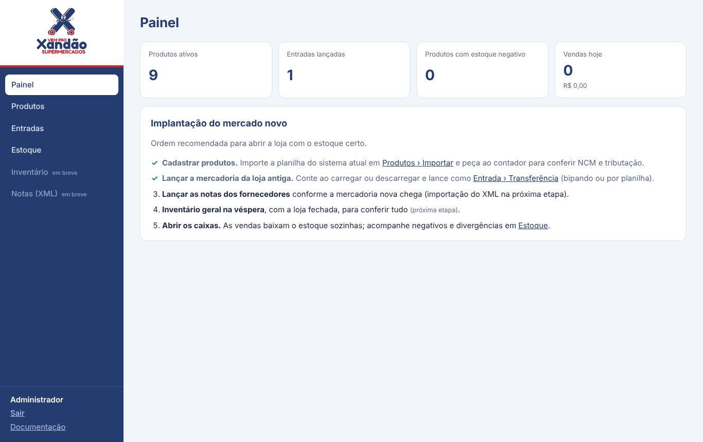 | 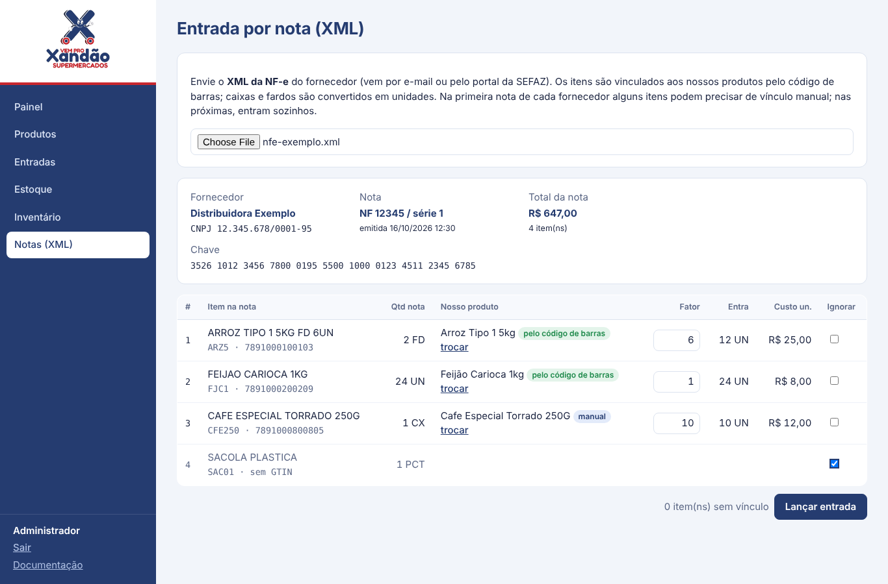 | 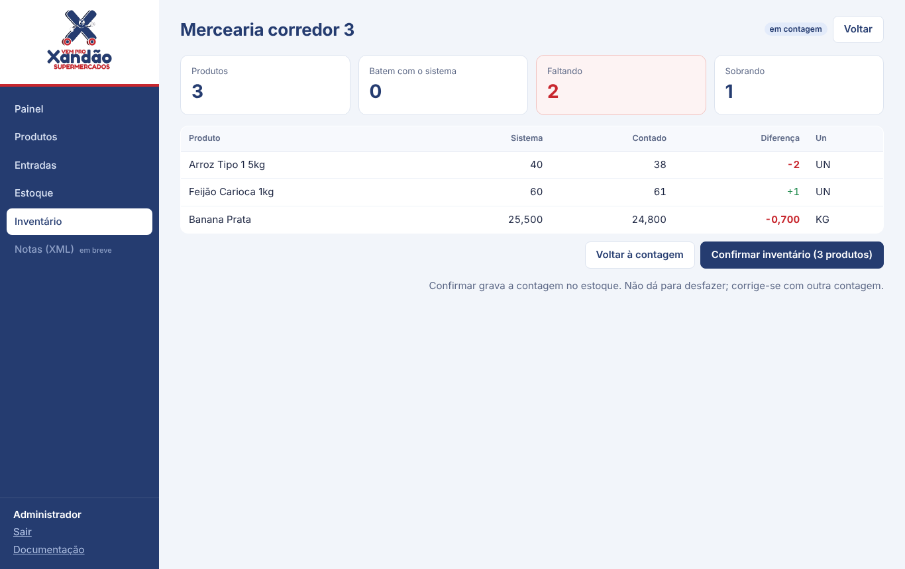 |
| **Vendas** | **Fechamentos** | **NFC-e** |
| 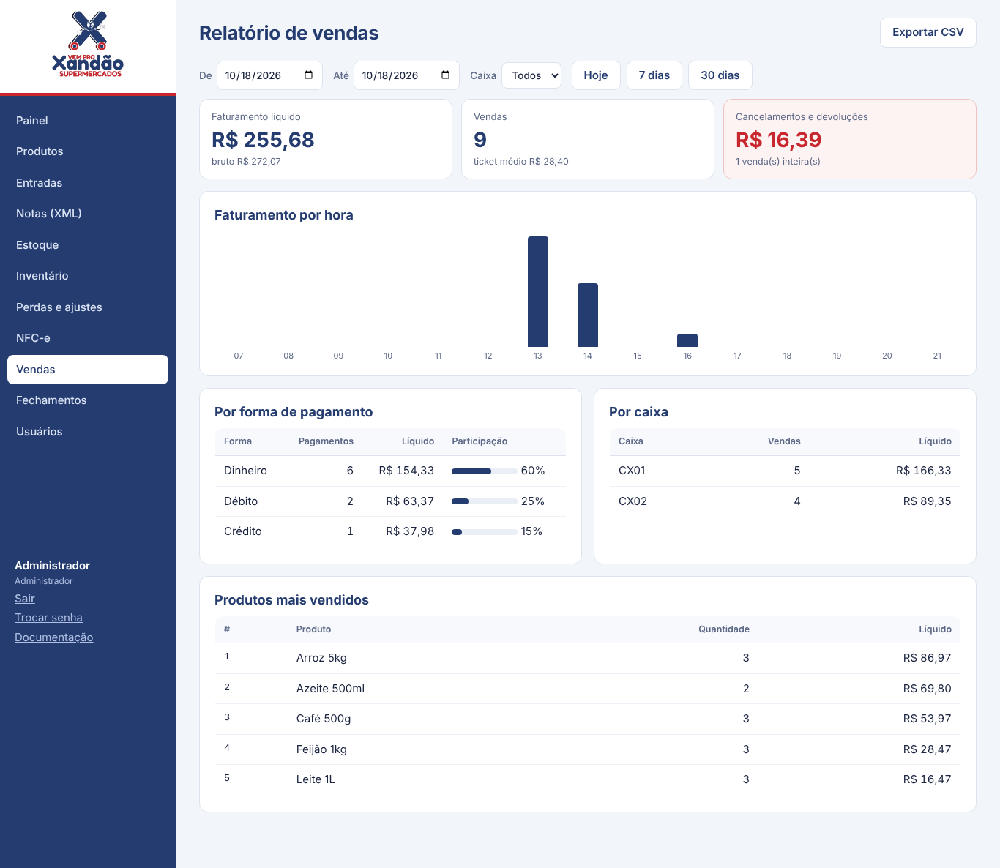 | 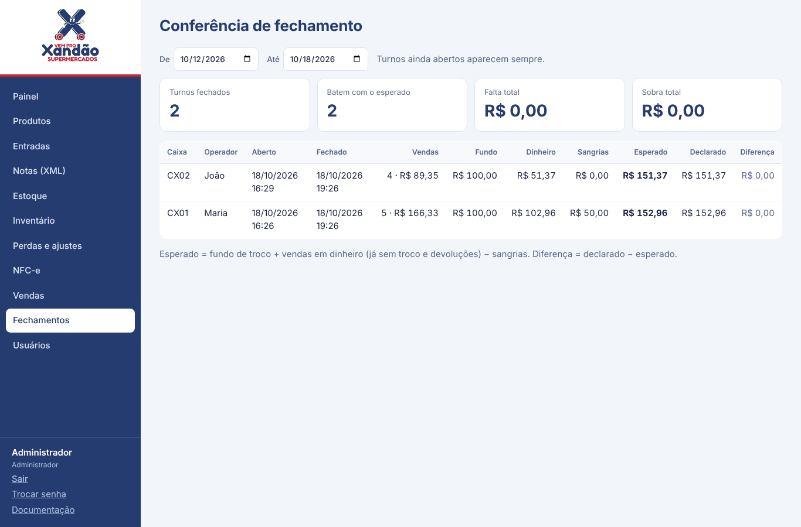 | 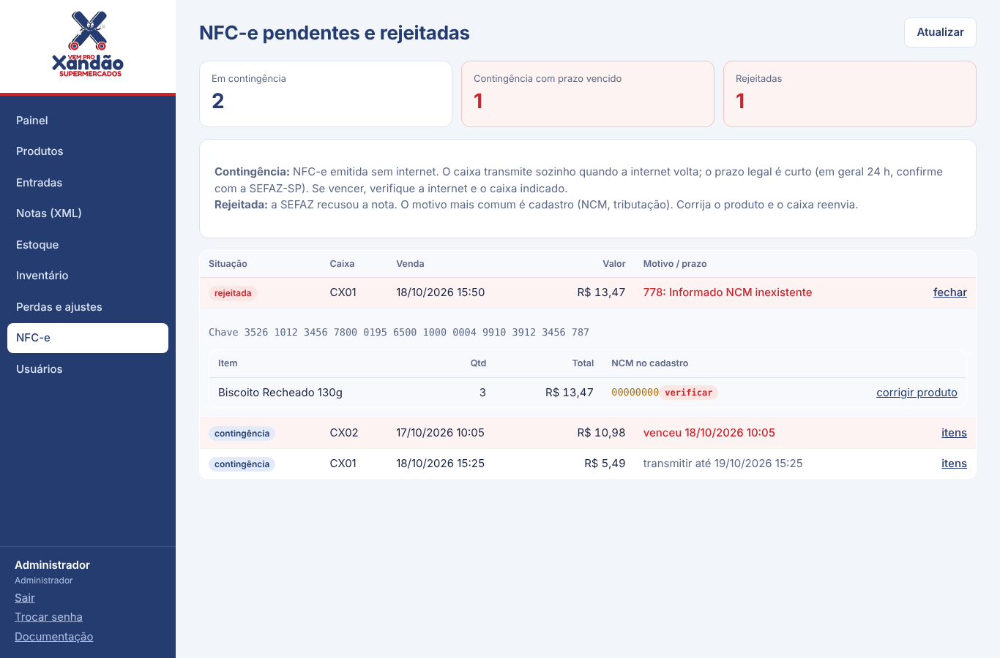 |
| **Nova entrada** | **Estoque** | **Usuários** |
| 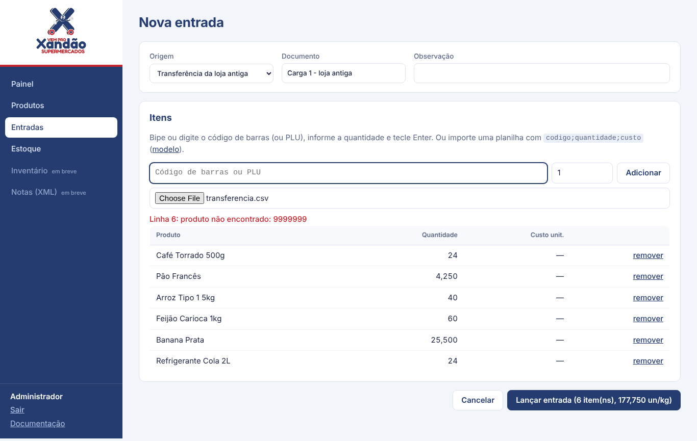 | 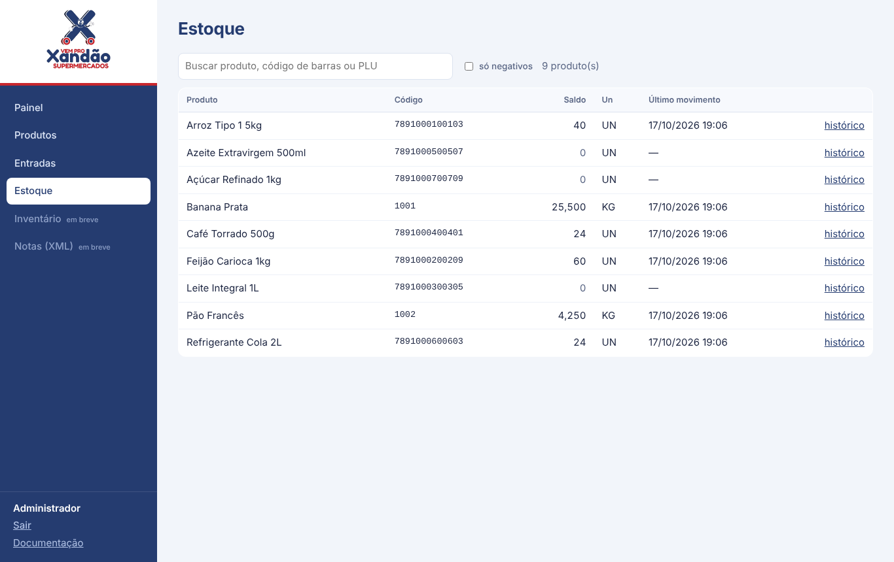 | 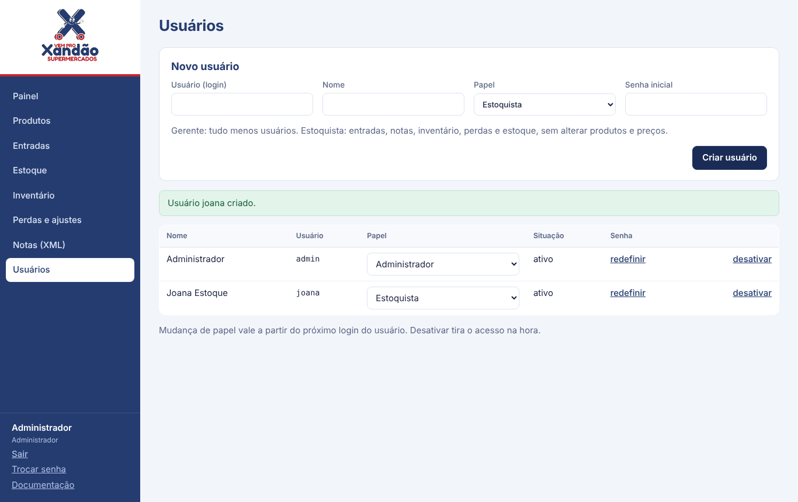 |

## Segurança

| Quem | Como se autentica | Configuração no servidor |
|---|---|---|
| Caixa → `/sync/*` | `X-Terminal-Id` + `X-Terminal-Key` | `Sync:Terminals:CX01 = <chave>` (uma por caixa). No caixa: `SYNTHIA_TERMINAL_KEY` ou `terminal.apiKey` |
| Pessoas → `/retaguarda` | Usuário e senha, cookie de 12 h | Usuários na própria retaguarda; admin inicial via `Backoffice:InitialAdminPassword` |
| Pessoas → `/backoffice/*` | O mesmo login da retaguarda (admin/gerente) | — |
| Integrações → `/backoffice/*` | `X-Api-Key` | `Backoffice:ApiKeys:0 = <chave>` |
| Qualquer um | — | `/health`, `/docs` e `/openapi/v1.json` são públicos |

- Um caixa só consegue enviar eventos **em nome dele mesmo**; lote com outro `terminalId` é recusado (403).
- Chaves comparadas em tempo constante; senhas só como hash (PBKDF2 do ASP.NET Identity).
- Em **desenvolvimento**, sem chaves de caixa configuradas, o sync aceita qualquer caixa (com aviso no log) para o
  modo demonstração funcionar. **Em produção, sem chaves, todo sync é recusado.** O back-office nunca é anônimo.
- API sem credencial responde 401/403 (não redireciona para a tela de login).

## Hardware do caixa

Os drivers seguem padrões de mercado e ficam atrás de contratos em `Terminal.Core/Devices`, com versões
simuladas para desenvolvimento. Cada caixa escolhe portas e modelos em `terminal.json`
([exemplo comentado](config/terminal.example.json)).

| Equipamento | Padrão adotado | Implementação |
|---|---|---|
| Leitor de código de barras | USB em modo teclado (de fábrica) ou serial | `KeyboardWedgeDetector` (reconhece leitura pela velocidade) · `SerialBarcodeScanner` |
| Balança de checkout | Serial, protocolo Toledo (ENQ → STX peso ETX) | `SerialScale` + `ToledoProtocol` |
| Impressora térmica 80 mm | ESC/POS por rede (RAW 9100), serial ou dispositivo | `EscPosPrinter` (CP850, QR Code, corte) |
| Gaveta | RJ11 na impressora | pulso ESC/POS |
| Pinpad / TEF | SiTef ou PayGo *(a decidir)* | `IPaymentTerminal` · `SimulatedPaymentTerminal` |
| Etiqueta da balança (MGV) | EAN-13 `2 + PLU(6) + total(5) + DV` | `ScaleBarcode` + `ScanResolver` |

O leitor resolve qualquer código pelo `ScanResolver`: primeiro o código exato do cadastro; se não houver e for uma
etiqueta de balança válida, o PLU com o **total impresso** (o cliente paga o da etiqueta e o peso vai para o
estoque). Formato de etiqueta, tamanho do PLU e "total ou peso" são configuráveis.

Implantação de um caixa: ligar os equipamentos, copiar `config/terminal.example.json` para `terminal.json`, ajustar
id, servidor, série da NFC-e e portas, conferir o formato da etiqueta no MGV e manter `ambiente: homologacao` até os
testes fiscais. O passo a passo e um decodificador de etiquetas estão em `/docs#hardware`.

## Começando

Requisitos: **.NET 10 SDK** e **PostgreSQL 16**.

```bash
# 1. banco de desenvolvimento (usuário e senha: synthia)
createuser -s synthia --pwprompt
createdb -O synthia synthia

# 2. servidor: aplica as migrações na subida
dotnet run --project src/Synthia.Server
# → http://localhost:5290/docs

# 3. testes (o usuário precisa poder criar bancos)
export SYNTHIA_TEST_PG="Host=localhost;Username=synthia;Password=synthia;Database=postgres"
dotnet test
```

A connection string do servidor fica em `src/Synthia.Server/appsettings.Development.json`
(`ConnectionStrings:Synthia`) e pode ser sobrescrita por variável de ambiente
(`ConnectionStrings__Synthia`).

## Documentação e console de API

O servidor serve a pasta [`docs/`](docs) e o documento OpenAPI:

| URL | O quê |
|---|---|
| `/` | Redireciona para `/docs/` |
| [`/docs/`](docs/index.html) | Arquitetura, topologia clicável, simulador de sync, eventos, **console de API ao vivo**, falhas, decisões |
| [`/docs/sistema.html`](docs/sistema.html) | **Visão geral animada**: arquitetura, infra, fluxo da venda, caixa, sync, estoque, retaguarda, falhas e implantação numa página só |
| [`/docs/simulacao.html`](docs/simulacao.html) | Execução real de um dia de loja, passo a passo |
| `/openapi/v1.json` | Documento OpenAPI 3 com todas as rotas, tags, resumos e schemas |

O console lê `/openapi/v1.json` e monta, para cada rota, um formulário com parâmetros e corpo de exemplo prontos
(IDs UUIDv7 novos a cada exemplo). **As chamadas são reais e gravam no banco do servidor.** Aberto direto como
arquivo, a página mostra a lista estática da API.

## API

| Método | Rota | O que faz |
|---|---|---|
| `POST` | `/sync/events` | Caixa envia lote (até 1000) de eventos. Devolve todos os `event_id` aceitos, inclusive os já existentes. |
| `GET` | `/sync/catalog?since={versão}` | Delta do catálogo em páginas de 500; `snapshotRequired` quando o caixa é novo, está à frente ou muito atrás. |
| `GET` | `/sync/catalog/snapshot` | Catálogo completo + preços agendados ainda válidos, numa leitura consistente. |
| `GET` | `/sync/store` | Cadastro da loja (nome, CNPJ, IE, endereço, rodapé, cores, `logoHash`, `version`). |
| `GET` | `/sync/store/logo` | Logo da loja (PNG/JPEG); `404` sem logo cadastrada. |
| `GET` | `/backoffice/products` | Cadastro atual. |
| `PUT` | `/backoffice/products/{id}` | Cria/altera produto e gera nova versão. Exclusão é `active = false`. |
| `POST` | `/backoffice/scheduled-prices` | Agenda preço para `effectiveAt`. |
| `POST` | `/backoffice/projections/rebuild` | Apaga as projeções e relê todo o log de eventos. |
| `GET` | `/health` | Verifica se o servidor está no ar. |

Rotas `/sync/*` exigem a chave do caixa; rotas `/backoffice/*` exigem login da retaguarda ou `X-Api-Key`
(ver [Segurança](#segurança)).

<details>
<summary>Exemplo: enviar uma venda</summary>

```http
POST /sync/events
Content-Type: application/json

{
  "events": [{
    "eventId": "01a14ae5-522d-7b3e-b6c0-264b99bcd42b",
    "streamId": "01a14ae5-522b-7183-b2f9-c526fa0733e6",
    "streamSeq": 1,
    "type": "SaleCompleted",
    "terminalId": "CX01",
    "occurredAt": "2026-10-17T17:25:05.197Z",
    "catalogVersion": 8,
    "payload": {
      "saleId": "01a14ae5-522b-7183-b2f9-c526fa0733e6",
      "shiftId": "01a14adc-b598-7da0-9d48-8c1f0e3a2b11",
      "items": [{ "itemId": "…", "productId": "…", "description": "Arroz 5kg",
                  "quantity": 2, "unitPriceCents": 2899, "totalCents": 5798 }],
      "payments": [{ "method": "cash", "amountCents": 6000, "tefNsu": null }],
      "totalCents": 5798, "changeCents": 202,
      "nfceKey": "3526…", "nfceStatus": "authorized"
    }
  }]
}
```

```json
{ "accepted": ["01a14ae5-522d-7b3e-b6c0-264b99bcd42b"] }
```
</details>

## Eventos

Todos com o mesmo envelope: `event_id`, `stream_id`, `stream_seq`, `type`, `terminal_id`, `occurred_at`,
`catalog_version`, `payload`. Valores monetários em **centavos**; quantidades em decimal (kg com 3 casas).

| Evento | Stream | Efeito no servidor |
|---|---|---|
| `ShiftOpened` | turno | Cria o turno com operador e fundo de troco. |
| `SaleCompleted` | venda | Baixa estoque, soma no turno, NFC-e pendente/rejeitada entra na fila. |
| `SaleItemCancelled` | venda | Estorna estoque e valor; com `refundMethod = cash`, sai do dinheiro esperado. |
| `SaleCancelled` | venda | Estorna itens ainda não estornados e o dinheiro ainda na gaveta; sai da fila de NFC-e. |
| `CashWithdrawal` | turno | Soma em sangrias. |
| `ShiftClosed` | turno | Guarda o dinheiro declarado para conferência. |
| `StockCounted` | produto | Saldo passa a ser a contagem + movimentos posteriores (inventário guarda o esperado e quem contou). |
| `StockReceived` | entrada | Soma ao estoque (transferência, fornecedor, nota XML com chave de acesso). |
| `StockAdjusted` | ajuste | Tira do estoque com motivo (quebra, vencimento, consumo, furto, devolução). |
| `NfceAuthorized` | venda | Remove da fila de NFC-e. |
| `NfceRejected` | venda | Fila do back-office com código e motivo. |

## Conflitos viram regras

| Situação | Regra |
|---|---|
| Dois caixas vendem a última unidade | Venda nunca é bloqueada. Estoque fica negativo e vira alerta. Estoque é ledger, não número editado. |
| Caixa offline vendeu com preço antigo | Vale o preço da venda; o evento carrega preço praticado e `catalog_version`. |
| Produto excluído vendido offline | Exclusão é lógica; o evento continua válido e referencia o ID. |
| Cancelamento | Sempre evento novo, nunca alteração do original. |
| Ajuste de inventário no expediente | `StockCounted` com timestamp; movimentos posteriores somam sobre a contagem. |

## Cenários de falha

| Falha | O que acontece | Recuperação |
|---|---|---|
| Servidor local cai | Caixas vendem; outbox acumula; catálogo congela | Servidor volta e drena as outboxes sozinho |
| Internet principal cai | Roteador muda para 4G | Automática |
| Internet total cai | Dinheiro: NFC-e em contingência. Cartão: só com fallback do adquirente | Transmissão das pendentes quando voltar |
| Nuvem cai | Nada muda na loja | Servidor reenvia o acumulado |
| Disco do caixa morre | Perde só eventos ainda não enviados (segundos) | Reinstala e baixa snapshot |
| Disco do servidor morre | Caixas seguem vendendo | `pg_dump` + replay das outboxes (30 dias) |

## Simulação de um dia de loja

[`tools/Synthia.Simulator`](tools/Synthia.Simulator) roda 27 passos (abertura, vendas, servidor fora, resposta
perdida, internet fora, contingência, conflitos, preço agendado, fechamento e rebuild) contra um **servidor real** e
**dois caixas reais**, gravando cada passo como *situação → rota → processo → resposta → efeito*.

```bash
tools/simulate.sh          # sobe servidor descartável, roda o roteiro e gera docs/simulacao-data.js
```

O resultado fica em [`/docs/simulacao.html`](docs/simulacao.html). Foi essa simulação que encontrou o bug do
estorno em dinheiro fora da gaveta, já corrigido.

## Marca e dados da loja

Nada da loja fica no código. Em **retaguarda > Loja** o admin cadastra nome, razão social, CNPJ, IE, endereço,
rodapé do cupom, logo e a cor da faixa.

**Co-marca:** a interface é sempre Synthia em todas as lojas. A loja aparece na logo (numa placa branca), numa faixa
de 4 px na cor dela logo abaixo e no cupom. A cor principal continua no cadastro e no `/sync/store`, mas não pinta a
tela. Tokens, logo e regras completas estão no guia de marca do Synthia.

- **Retaguarda:** a logo sai de `/retaguarda/marca/logo` e a cor da faixa de `/retaguarda/marca.css` (`--tenant-accent`); sem cadastro, vale a
  logo padrão do produto ([`tools/branding/make_default_logo.py`](tools/branding/make_default_logo.py)).
- **Caixa:** puxa `/sync/store` a cada minuto, guarda a cópia no SQLite e a logo num arquivo ao lado do banco, e
  funciona com ela offline. A logo só é baixada de novo quando o `logoHash` muda. Nome, logo e a faixa trocam na tela
  sem reiniciar.
- **Cupom:** nome, IE, endereço e rodapé vêm do cadastro; o **CNPJ é sempre o do `terminal.json`**, porque é o do
  certificado e compõe a chave da NFC-e. Se os dois divergirem, o caixa mostra um aviso.
- Cada loja tem um `storeId` (UUID gerado na instalação): é a chave dela quando a nuvem atender várias lojas.

O Xandão é o cliente zero. A logo dele com fundo transparente ([`docs/img/logo-xandao.png`](docs/img/logo-xandao.png)) e a variante com contorno
branco para fundos coloridos ([`logo-xandao-contorno.png`](docs/img/logo-xandao-contorno.png)) foram extraídas de um
print por [`tools/branding/make_logo.py`](tools/branding/make_logo.py), que mantém os brancos do desenho (olhos,
luvas, contorno do X) e vaza o miolo das letras. Com a arte original em vetor, basta trocar os PNGs.

## Estrutura do repositório

```
src/
  Synthia.Contracts        envelope, payloads, mensagens de sync, Uuid7, JSON comum
  Synthia.Terminal.Core    LocalDb, Outbox, LocalCatalog, Cart, SaleService, ShiftService,
                           CheckoutSession, ReceiptBuilder, NfceKey/NfceNumbering, ScanResolver,
                           OutboxPusher, CatalogPuller, TerminalConfig, contratos de dispositivos
  Synthia.Terminal.Devices balança Toledo, ESC/POS, leitor serial, dispositivos simulados
  Synthia.Terminal.App     app do caixa (Avalonia): abertura de turno, venda, pagamento
  Synthia.Server           Migrator + SQL, EventStore, Projector, CatalogService, OpenAPI, /docs
                           Backoffice/ (usuários, estoque, importações) e Retaguarda/ (Blazor)
tests/
  Synthia.Terminal.Tests   caixa com SQLite temporário, relógio e servidor falsos
  Synthia.Server.Tests     servidor contra Postgres real, docs/OpenAPI, ponta a ponta
  Synthia.Terminal.App.Tests  tela do caixa sem monitor (Avalonia headless), gera as capturas
config/
  terminal.example.json    configuração comentada de um caixa
tools/
  branding/make_logo.py    extrai a logo transparente de um print
  Synthia.Simulator        roteiro de um dia de loja
  simulate.sh              executa o simulador contra um servidor descartável
docs/
  index.html               documentação interativa + console de API
  simulacao.html           visualizador da simulação
  sistema.html             visão geral animada do sistema inteiro (arquivo único)
```

## Testes

```bash
dotnet test
```

- **Caixa:** venda, troco, balança, contingência, turno, preço agendado, exclusão lógica, outbox em lotes,
  drenagem após queda, poda de 30 dias, ordem do `Uuid7`.
- **Dispositivos:** etiqueta EAN-13 e dígito verificador, protocolo Toledo, ESC/POS (acentos, colunas, QR, gaveta),
  detecção de leitor em modo teclado, `terminal.json` e fábrica de dispositivos.
- **Servidor:** idempotência, estoque negativo, contagem, cancelamentos e devoluções na gaveta, fila de NFC-e,
  rebuild, delta/snapshot do catálogo, `/docs` e OpenAPI.
- **Checkout:** multiplicador, balança (estável, instável, sem balança), etiqueta, pagamento misto, TEF negado,
  estorno ao sair do pagamento, impressora fora, sangria, chave e numeração da NFC-e.
- **Tela do caixa (headless):** abre turno, vende pelo teclado, paga em débito + dinheiro, descarta com Esc,
  sangria e fechamento. `SYNTHIA_SCREENSHOTS=docs/img dotnet test tests/Synthia.Terminal.App.Tests` regenera as capturas.
- **Ponta a ponta:** caixa SQLite baixa catálogo, vende e o servidor Postgres projeta estoque e turno.

O CI (GitHub Actions) roda build e testes com um Postgres 16 de serviço.

## Roadmap e decisões em aberto

- [ ] Integração ACBrLib (emissão, contingência, worker de transmissão, inutilização no fim do dia)
- [x] Camada de dispositivos (leitor, balança, impressora/gaveta, TEF simulado) e etiqueta de balança
- [x] App do caixa: turno, venda, balança, pagamentos, sangria, fechamento, DANFE
- [ ] Tela de inventário e consulta de preço
- [ ] Campos tributários no produto (CFOP, CST/CSOSN, origem, CEST, alíquotas)
- [ ] Operadores, login no caixa e permissão de supervisor
- [x] Retaguarda: login, produtos com importação, entradas (transferência), estoque e histórico
- [x] Retaguarda: importação de XML da NF-e, inventário, perdas e ajustes, usuários e papéis
- [x] API autenticada: chave por caixa no sync, login ou chave de API no back-office
- [x] Retaguarda: fila de NFC-e, relatório de vendas com exportação e conferência de fechamento
- [ ] Integração real com ACBr (NFC-e) e TEF; worker de contingência no caixa
- [x] Multi-loja: identidade, cupom e marca da loja no cadastro da retaguarda, sincronizados com os caixas
- [ ] Outbox servidor → nuvem e serviço da nuvem (multi-tenant por `storeId`)
- [ ] Assinatura: ativação do caixa por chave, licença com tolerância offline, atualização automática
- [ ] NFC-e fora de SP: URLs de consulta/QR Code por UF (a ACBr já tem a tabela) e responsável técnico
- [ ] Servidor com standby ou aceitar horas fora? · Edição de preço pela nuvem no MVP?
- [ ] TEF: PayGo ou SiTef, e fallback offline para cartão
- [ ] Contador: CSOSN/CST, NCM e regime tributário antes da primeira NFC-e em produção

## Convenções

- Commits em inglês no padrão [Conventional Commits](https://www.conventionalcommits.org/)
  (`feat(server): …`, `fix(terminal): …`, `docs: …`), pequenos e focados.
- Código e comentários em português do domínio (caixa, sangria, turno); identificadores em inglês.
- Dinheiro sempre em centavos (`long`); datas em UTC.
